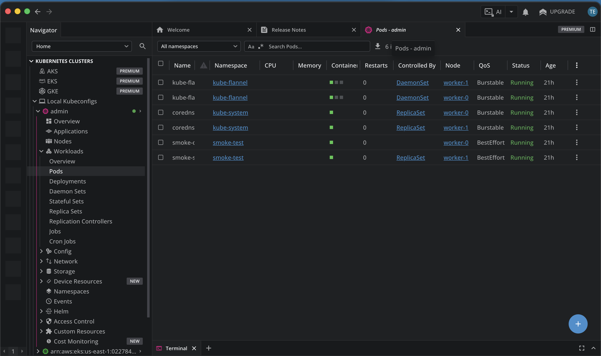
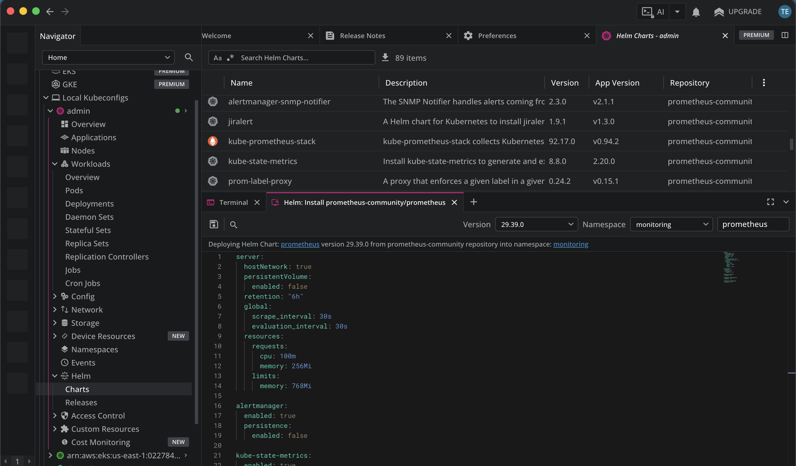
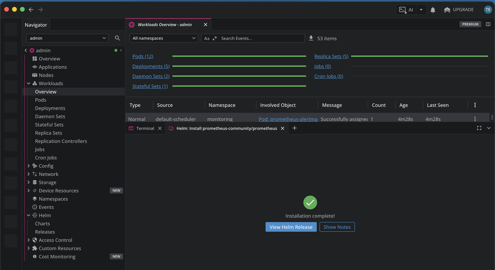
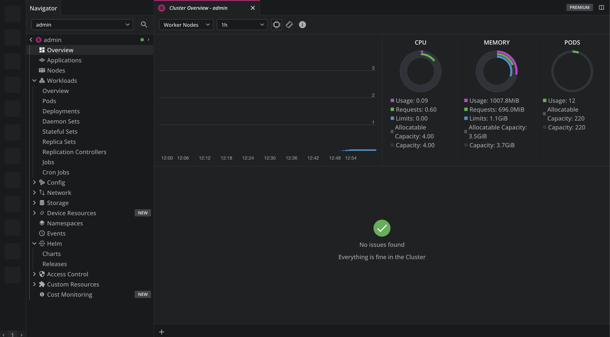

# Kubernetes lab on AWS

This project builds a small Kubernetes cluster on three EC2 instances. Terraform creates the AWS infrastructure, and Ansible installs and configures the cluster components.

The control plane runs as systemd services. Certificates, kubeconfigs, networking and DNS are configured explicitly as part of the assignment.

## Cluster layout

AWS region: `eu-central-1`  
Instance type: `t3.small`  
Operating system: Ubuntu 24.04  
Kubernetes version: `1.36.5`

| Host | Private IP | Role |
|---|---|---|
| controller-0 | 10.20.1.10 | API server, controller manager, scheduler and etcd |
| worker-0 | 10.20.1.20 | Worker node |
| worker-1 | 10.20.1.21 | Worker node |

- Pod network: `10.244.0.0/16`
- Service network: `10.96.0.0/24`
- Cluster DNS: `10.96.0.10`
- Pod networking: Flannel
- DNS: CoreDNS
- Container runtime: containerd

Only the workers appear in `kubectl get nodes`. The controller runs the control plane services without a kubelet.

There is one control plane and one etcd member. This is a temporary lab, so it does not provide high availability.

## What Ansible does

The first play in `site.yml` prepares all three hosts: it installs packages, sets hostnames, enables time synchronization, disables swap and configures the kernel networking settings.

The remaining work is split into roles:

| Role | What it configures |
|---|---|
| `generate-certs` | CA, component TLS certificates and ServiceAccount signing keys |
| `generate-configs` | Client kubeconfigs, a persistent 32-byte encryption key and the Secret encryption configuration |
| `bootstrap-etcd` | A TLS-protected etcd member |
| `setup-control-plane` | API server, controller manager, scheduler and kubelet access permissions |
| `setup-worker-nodes` | containerd, CNI plugins, kubelet and kube-proxy |
| `configure-kubectl` | Remote API access check and the local kubectl environment file |
| `setup-networking` | Flannel and CoreDNS |
| `smoke-test` | DNS, exec, logs, cross-node HTTP and Secret encryption checks |

## Before running it

The local machine needs:

- AWS CLI with the `aws-learning` profile configured
- Terraform
- Ansible with the `community.crypto` collection
- `cryptography` installed in the Python environment used by Ansible
- kubectl and OpenSSL

Check AWS access:

```bash
aws sts get-caller-identity \
  --profile aws-learning \
  --region eu-central-1
```

For a fresh checkout, create the SSH key used by Terraform and Ansible:

```bash
mkdir -p .secrets
chmod 700 .secrets

ssh-keygen -t ed25519 \
  -f .secrets/k8s-lab \
  -N '' \
  -C week10-k8s

ansible-galaxy collection install community.crypto
```

The `.secrets` directory holds private keys, generated certificates, kubeconfigs and the encryption configuration. It is excluded from Git.

## Create the cluster

Run these commands from the project root:

```bash
terraform -chdir=terraform init
./update-access.sh
```

Terraform creates the VPC, public subnet, Internet Gateway, routing, Security Group, SSH key pair and three EC2 instances.

`update-access.sh` detects the current public IP of the local machine, updates `admin_cidr`, runs Terraform and writes the EC2 addresses into the Ansible inventory. Terraform asks for confirmation before applying changes.

Then install Kubernetes:

```bash
cd ansible

ansible k8s -b -m ping
ansible-playbook site.yml --syntax-check
ansible-playbook site.yml
```

Load the generated admin kubeconfig:

```bash
source ../.secrets/kubectl-env.sh

kubectl get nodes -o wide
kubectl get pods -A
```

In a new terminal, source the environment file again before using kubectl.

## Check the cluster

From the `ansible` directory:

```bash
ansible-playbook site.yml --tags smoke-test
```

The role creates its resources in the `smoke-test` namespace. The client runs on `worker-0`, and the HTTP server runs on `worker-1`, so the HTTP request through the Service crosses the node boundary.

The tests also execute commands inside a Pod, read container logs and resolve the Kubernetes Service through cluster DNS.

For encryption, the role writes a test Secret, reads its value through the API and checks the raw etcd record for this prefix:

```text
k8s:enc:secretbox:v1:key1:
```

The final test rerun completed with `changed=0`, `unreachable=0` and `failed=0`.

Useful commands for checking the current state:

```bash
kubectl get nodes -o wide
kubectl get pods -A
kubectl get --raw='/readyz?verbose'
kubectl -n smoke-test get pods -o wide
```

Both workers should be `Ready`. Flannel, CoreDNS and the automated test Pods should be running.

## Open the test application

The test application uses an internal ClusterIP Service. To access it from the local browser:

```bash
kubectl -n smoke-test port-forward service/smoke-server 8080:80
```

Keep that command running and open:

```text
http://localhost:8080
```

The response should be `smoke-ok`. Press `Ctrl+C` to close the tunnel.

## Issues encountered

### SSH stopped working after an IP change

The Security Group allowed access from the previous public IP. Updating `admin_cidr` restored access. This is now handled by `update-access.sh`.

### Ansible used old EC2 addresses after recreating the infrastructure

The inventory still contained public IPs from the previous instances. Generating it from Terraform outputs fixed this and removed the need to edit addresses manually.

### Workers initially showed NotReady

The workers registered before a Pod network was available. They became `Ready` after Flannel was deployed.

### The short DNS test produced an attach warning

The DNS lookup succeeded, but kubectl reported that it could not attach to the container. I repeated the query through a long-running Pod and checked both exec and logs successfully.

### Repeating kubectl expose returned AlreadyExists

The Service had already been created. The automated tests use `kubectl apply`, which reuses existing resources on later runs.

## Remove the infrastructure

Once the checks and documentation are finished, run this from the project root:

```bash
terraform -chdir=terraform destroy
terraform -chdir=terraform state list
```

After destruction, verify in AWS that the lab instances and their root EBS volumes have been removed. The local Terraform and Ansible files remain available to recreate the cluster.

## Lens and monitoring

I connected Lens using the generated admin kubeconfig. Metrics Server `v0.9.1` is installed using [metrics-server.yaml](metrics-server.yaml), with the API aggregation certificates and API server flags managed by Ansible.

Prometheus was installed through Lens using chart `prometheus-community/prometheus` version `29.39.0`. The release is named `prometheus` in the `monitoring` namespace, and its Helm overrides are in [prometheus-values.yaml](prometheus-values.yaml).

Lens uses the `Helm` query format and service address `monitoring/prometheus-server:80`. Prometheus uses temporary storage, so recreating its Pod clears the collected history.

The screenshots and terminal output below were captured while the lab was running. The node and `kubectl top` checks were recorded before Prometheus was installed; the monitoring Pod list and final Lens graphs were recorded afterwards.

### Connecting Lens to the cluster

After importing the admin kubeconfig, Lens showed the existing Flannel, CoreDNS and smoke-test Pods:



The node check confirmed that both workers were ready:

```text
kubectl get nodes -o wide

NAME       STATUS   ROLES    AGE   VERSION   INTERNAL-IP   EXTERNAL-IP   OS-IMAGE             KERNEL-VERSION       CONTAINER-RUNTIME
worker-0   Ready    <none>   99s   v1.36.5   10.20.1.20    <none>        Ubuntu 24.04.5 LTS   7.0.0-1014-aws       containerd://2.3.6
worker-1   Ready    <none>   99s   v1.36.5   10.20.1.21    <none>        Ubuntu 24.04.5 LTS   7.0.0-1014-aws       containerd://2.3.6
```

### Installing Prometheus through Helm

I selected the `monitoring` namespace and applied the overrides from `prometheus-values.yaml` in the Lens Helm editor:



Lens then reported that installation had completed:



### Checking the monitoring components

All five monitoring Pods became ready, with no restarts. The readiness request also confirmed that Prometheus was reachable through the Kubernetes API proxy:

```text
kubectl -n monitoring get pods -o wide

NAME                                              READY   STATUS    RESTARTS   AGE     IP            NODE       NOMINATED NODE   READINESS GATES
prometheus-alertmanager-0                          2/2     Running   0          2m39s   10.244.1.4    worker-1   <none>           <none>
prometheus-kube-state-metrics-86f6b846bf-8cpr9       1/1     Running   0          2m39s   10.244.0.4    worker-0   <none>           <none>
prometheus-prometheus-node-exporter-drs9j           1/1     Running   0          2m39s   10.20.1.21    worker-1   <none>           <none>
prometheus-prometheus-node-exporter-xvwrg           1/1     Running   0          2m39s   10.20.1.20    worker-0   <none>           <none>
prometheus-server-7d8fb789c8-nfmlj                   2/2     Running   0          2m39s   10.20.1.20    worker-0   <none>           <none>

kubectl get --raw='/api/v1/namespaces/monitoring/services/http:prometheus-server:80/proxy/-/ready'

Prometheus Server is Ready.
```

### Checking CPU and memory metrics

These readings confirmed that Metrics Server was serving node and Pod metrics before the Prometheus installation:

```text
kubectl top nodes

NAME       CPU(cores)   CPU(%)   MEMORY(bytes)   MEMORY(%)
worker-0   29m          1%       555Mi           30%
worker-1   32m          1%       568Mi           31%

kubectl top pods -A

NAMESPACE      NAME                                      CPU(cores)   MEMORY(bytes)
kube-flannel   kube-flannel-ds-62lgv                      7m           11Mi
kube-flannel   kube-flannel-ds-qgzvv                      6m           11Mi
kube-system    coredns-7cb688565b-d6b6x                   1m           11Mi
kube-system    coredns-7cb688565b-n82d4                   1m           11Mi
kube-system    metrics-server-64b95ddcc8-xgpx9            3m           19Mi
smoke-test     smoke-client                              0m           0Mi
smoke-test     smoke-server-7c8c699d67-hbgc6              1m           0Mi
```

After Prometheus started collecting data, Lens displayed CPU and memory usage, resource requests and limits, and the cluster's 12 Pods. The graph covers the period since Prometheus was installed:



